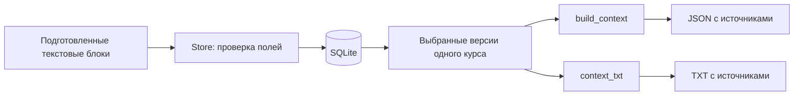

# Архитектура учебного ядра

`otmetki_core` — Python-пакет без внешних runtime-зависимостей. Его основа — SQLite, структурированные текстовые блоки и экспорт со ссылками на версии источников.

## Модули

| Путь в пакете | Назначение |
| --- | --- |
| `store.py` | Валидация данных, миграции, запись и чтение SQLite, создание версий материалов. |
| `context.py` | Сборка выбранного контекста, консервативное удаление повторов и TXT. |
| `api.py` | Независимая от транспорта функция `dispatch` и локальный HTTP адаптер. |
| `cli.py`, `__main__.py` | Команды `init`, `demo`, `serve` и `context`. |
| `demo.py` | Вымышленные учебные записи без назначенных дат. |
| `migrations/` | Нумерованные SQL-миграции с контрольными суммами. |
| `web/` | HTML, CSS и JavaScript демонстрационной страницы, без внешних запросов. |

Экспортируются `Store`, `InvalidInput`, `NotFound`, `Conflict`, `build_context` и `context_txt`. Для HTTP-контракта приложение может вызвать `otmetki_core.api.dispatch` после собственных проверок доступа.

## Поток данных

Материал привязан к курсу и необязательной теме. Его содержимое хранится в `material_revisions`. Правка создаёт следующий снимок; предыдущий текст читается по номеру версии. Источник в контексте содержит идентификатор материала, версию и идентификатор блока, а также страницу или слайд, если их передал импортёр.

## Направления и аудитория

Один предмет может иметь курсы для разных направлений, учебных групп и семестров. Комбинация предмета, направления, `cohort` и семестра уникальна. Каталог фильтруется по направлению и группе.

В демо направление выбирается вручную для показа примеров. В настоящем приложении его должен определять проверенный профиль. Сам фильтр не препятствует обращению к другому курсу через API и не заменяет серверную проверку доступа.

## Удаление повторов

`build_context` не изменяет оригиналы. Оно объединяет одинаковые достаточно длинные блоки одного вида и курса при совпадении области применения; у объединённого блока остаются все ссылки на источники.

- Обычный текст сравнивается после Unicode NFC и нормализации пробелов.
- Для формул и таблиц сохраняется внутренняя структура пробелов и строк.
- Короткие блоки длиной менее 24 символов не объединяются между разными позициями.
- Явное поле `scope` различает область применения. Цепочка обнаруженных условий сохраняется до конца материала, независимо от расстояния между блоками; новые условия дополняют её. Без достоверных границ раздела алгоритм предпочитает оставить возможный повтор, а не потерять условие.
- Различающиеся числа, знаки, формулировки и условия не объединяются по смыслу.

Это осторожная эвристика для точных повторов, а не доказательство смысловой эквивалентности. Импортёр должен передавать `scope`, когда знает границы вариантов или разделов.

## Что остаётся вне пакета

Аутентификация, роли, подтверждение статуса разработчика, пользовательские профили, административные права, рабочие интеграции, уведомления и выпуск реализуются отдельно. У ядра нет документов пользователей, модели ИИ или сетевого импортёра.

Вызывающее приложение также отвечает за лимиты ресурсов, резервное копирование, разграничение доступа к файлу SQLite и защиту публичного HTTP сервера. `LocalServer` предназначен только для демонстрации на одной машине.

## Самостоятельный сайт и Mini App

`app/src/components/Workspace.tsx` содержит единую оболочку для браузера и Telegram. На узком экране разделы открываются через кнопку в верхней панели и выдвижное меню; `TelegramBridge` согласует высоту и кнопку назад с контейнером. Учётная запись определяется серверной сессией, а не именем клиента.

`app/src/lib/platform.ts` проверяет аудитории, членство и готовность функций. `db.ts` содержит локальные миграции и версии материалов; вложенные изменения выполняются через SQLite savepoints. `processing.ts` запускает ограниченный Python worker и отдельно распознаёт изображения через настроенный ИИ. `chat-runtime.ts` сохраняет сообщения и версии источников, отдавая поток через AI SDK. `chat-privacy.ts` закрывает технические результаты чтения источников после отзыва прав.

Нет сетевого скачивания по произвольной ссылке, действий в учебных системах и автоматического запуска генерации при изменении файла. Все функции проверяют доступ на сервере. Запуск рассчитан на один процесс; очереди и активные потоки находятся в его памяти.
