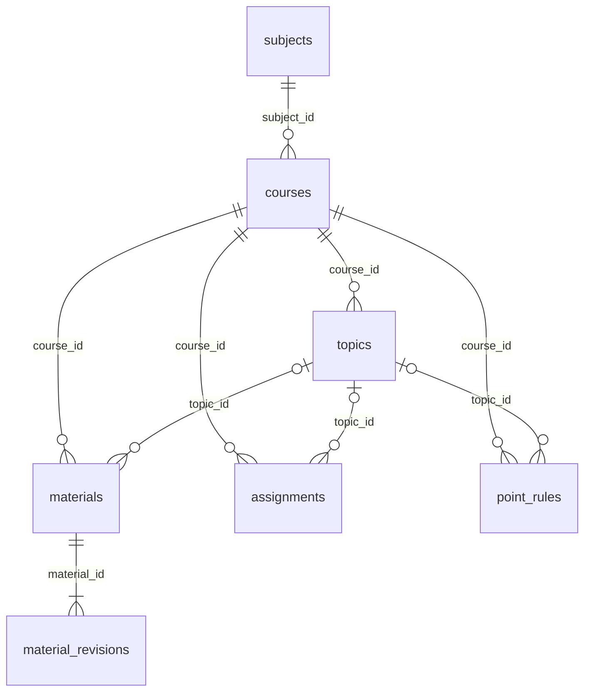

# Модель данных

Это полная схема именно учебного ядра. Она не описывает внутреннюю базу какого-либо рабочего сервиса. Имена столбцов SQLite используют `snake_case`; библиотека и API возвращают соответствующие поля в `camelCase`.

## Связи



Все внешние ключи объявлены с `ON DELETE RESTRICT`; `Store` включает `PRAGMA foreign_keys = ON` для каждого соединения. Маршрутов удаления в текущем API нет.

## Таблицы

| Таблица | Поля | Правила |
| --- | --- | --- |
| `subjects` | `id`, `code`, `title`, `created_at` | `id` — первичный ключ, `code` уникален. |
| `courses` | `id`, `subject_id`, `direction`, `cohort`, `semester`, `title`, `created_at` | Направление `management` или `economics`; семестр 1–12. Уникальна комбинация `subject_id`, `direction`, `cohort`, `semester`. |
| `topics` | `id`, `course_id`, `title`, `position`, `created_at` | `position` неотрицателен; порядок чтения — `position`, затем `id`. |
| `materials` | `id`, `course_id`, `topic_id`, `current_version`, `created_at`, `updated_at` | Необязательная тема; `current_version` ≥ 1. Содержимое хранится в отдельной таблице снимков. |
| `material_revisions` | `material_id`, `version`, `title`, `kind`, `status`, `external_url`, `blocks_json`, `warnings_json`, `created_at` | Первичный ключ — пара `material_id`, `version`; `version` ≥ 1; оба JSON-столбца проверяются через `json_valid`. |
| `assignments` | `id`, `course_id`, `topic_id`, `title`, `kind`, `description`, `starts_at`, `due_at`, `tentative`, `max_points`, `version`, `created_at`, `updated_at` | Необязательные тема, сроки и баллы; `tentative` равен 0 или 1; `version` ≥ 1. |
| `point_rules` | `id`, `course_id`, `topic_id`, `title`, `description`, `max_points`, `created_at` | Необязательные тема и баллы. Правило описывает возможные баллы, а не оценку конкретного человека. |
| `schema_migrations` | `version`, `checksum`, `applied_at` | Создаётся библиотекой для учёта применённых миграций; первичный ключ — номер миграции. |

Материалы имеют вид `lecture`, `seminar`, `reference` или `glossary`; статус — `ready` или `limited`. Задания имеют вид `homework`, `test`, `independent`, `exam` или `project`.

Для `assignments.max_points` и `point_rules.max_points` SQL допускает `NULL` либо неотрицательное значение. Библиотека дополнительно отвергает бесконечность, NaN и логические значения.

## Блоки материала

`blocks_json` содержит массив следующего вида:

```json
[
  {
    "id": "example-formula",
    "kind": "formula",
    "text": "y = a + b x",
    "page": 1,
    "scope": "example-linear-model"
  }
]
```

| Поле | Значение |
| --- | --- |
| `id` | Непустая строка до 96 символов; уникальна внутри материала. При отсутствии создаётся автоматически. |
| `text` | Строка, допускается пустая. До 1 000 000 символов на блок и 2 000 000 на материал. |
| `kind` | `text`, `table` или `formula`; по умолчанию `text`. |
| `page`, `slide` | Необязательные целые числа 1–10 000. Нумерация начинается с 1. |
| `scope` | Необязательная строка до 2 000 символов, которая разделяет области применения при удалении повторов. |
| `warning` | Необязательное предупреждение о конкретном блоке до 2 000 символов. |

Максимум — 1 000 блоков. `warnings_json` — до 100 непустых предупреждений по материалу, каждое до 2 000 символов. Структуру и виды блоков проверяет Python-валидация; SQLite проверяет корректность JSON, но не его прикладную форму.

## Версии и защита от потери правок

Создание материала атомарно добавляет запись `materials` и снимок версии 1. `update_material` требует `expectedVersion`. Обновление указателя выполняется только если ожидаемая версия ещё текущая; затем в той же транзакции создаётся новый снимок. При несовпадении возвращается `Conflict`, в HTTP — 409.

Старые снимки не изменяются методами библиотеки. SQL-схема не содержит запрета на прямой ручной `UPDATE` снимков; обращаться к ним в обход `Store` нельзя, если требуется сохранить обещанную историю. Привязку материала к курсу и теме текущий метод правки не меняет.

Ответ материала содержит и `version` выбранного снимка, и `currentVersion`. `createdAt` в этом ответе — время создания снимка. Чтение исторической версии возвращает исторические заголовок, вид, статус, ссылку, блоки и предупреждения.

У заданий поле `version` сейчас создаётся равным 1; API правки и истории заданий ещё нет. Не следует считать его готовым журналом изменений.

## Дополнительные проверки библиотеки

- `code` предмета начинается с латинской строчной буквы и далее допускает строчные буквы, цифры, `_` и `-`, длина до 64 символов.
- Заголовки — непустые строки до 240 символов; `cohort` — до 96.
- Тема для материала, задания или правила должна принадлежать выбранному курсу. Это проверка `Store`, а не составной внешний ключ SQL.
- `startsAt` и `dueAt` при наличии обязаны содержать часовой пояс и нормализуются в UTC. Начало не может быть позже срока сдачи.
- `externalUrl` — HTTPS-ссылка до 2 000 символов, без логина и пароля. Хранение ссылки не означает загрузку её содержимого.
- Неизвестные поля входного объекта отклоняются.

## Миграции

Файлы имеют имена `001_initial.sql`, `002_…sql` и далее. При открытии `Store` они применяются в порядке имени. Для каждого сохраняются номер, SHA-256 и время применения. Изменение содержимого уже применённого файла вызывает `Conflict`.

Новые миграции выполняются в транзакции `BEGIN IMMEDIATE`; неудачная миграция откатывается. Изменение полей требует новой миграции и теста перехода с предыдущей схемы. Каталог содержит индексы для фильтра курсов, тем и коллекций курса; отдельные серверные роли и персональные записи в этой схеме отсутствуют.
